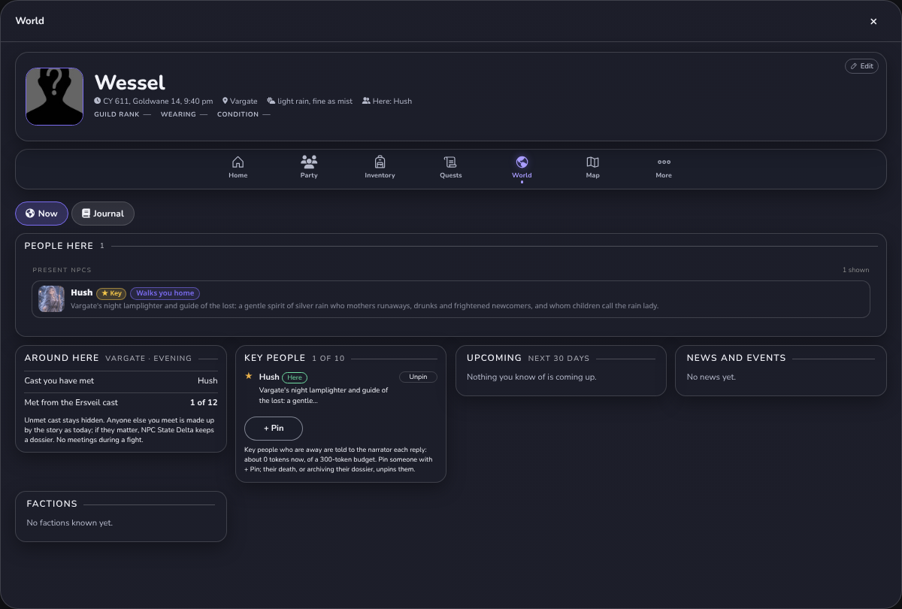
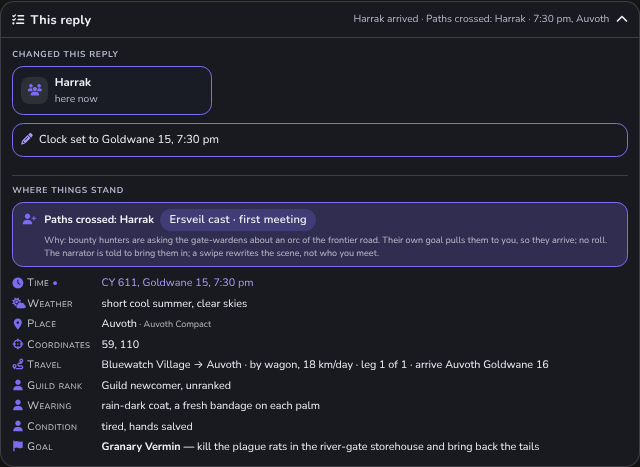
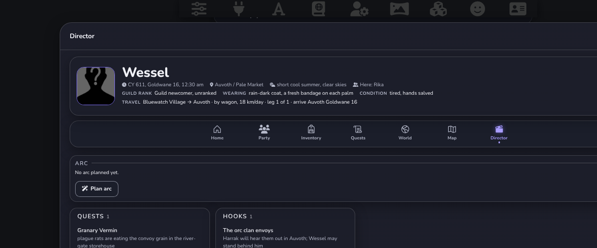
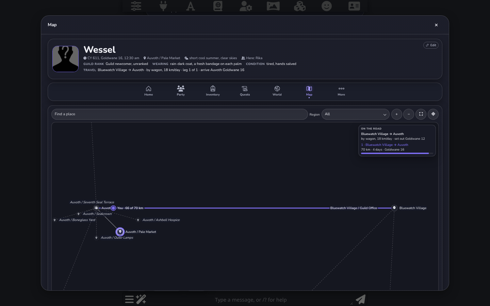
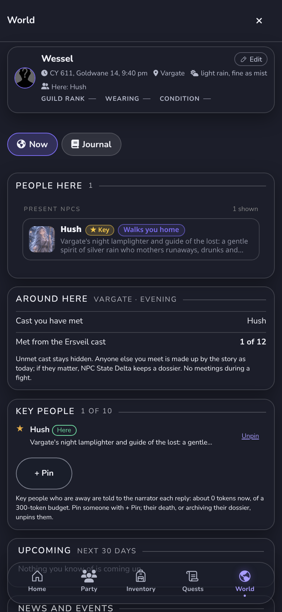

# Story Director 2.11.2

Story Director is an extension for SillyTavern that gives your story a clock and a memory. It keeps the date and time, the weather, your quests, the open leads, the map and the wider world. It also keeps people you follow while they are away, and, if a pack has a cast, it lets that cast live off-screen. The narrator writes what changed at the end of each reply. Story Director keeps it and shows you the result in plain words.

*The World screen: who is here, where you are, and the people the story keeps going.*

For AI assistants that read this repository, see [AI-README.md](AI-README.md).

## Install

1. Install [Story Block](https://github.com/kohz87/Story_block) first. In SillyTavern, open **Extensions → Install extension** and paste its address.
2. Install Story Director the same way: `https://github.com/kohz87/Story_director`.
3. Optional: install [NPC State Delta](https://github.com/kohz87/npc_state_delta) for a dossier on each person you meet. Story Director works without it.
4. Reload SillyTavern. When you update, update Story Block before the others.

Story Director needs Story Block 2.25.0 or later. Use the newest Story Block (2.25.0) to get the clock edit (2.16.0) and the cast (2.15.0). Without Story Block, Story Director only shows a one-line notice in the extensions drawer.

[Story Studio](https://github.com/kohz87/Story_studio) is not an extension. It is one page you open in a browser to write packs. To try a world, import the Ersveil example pack that comes with Story Block (see its README). It has a calendar, places, roads and a cast.

## What you see and do

Story Director adds screens to Story Block's **Game view** (the **Game view** button above the message box, or Alt+G). **Quests**, **World** and **Map** sit in the bar. **Director** and **Chronicle** are under **More**. You choose the bar in **Settings → Tabs & Packs**. The same screens open as a panel with the **Story** button.

**The clock.** Story Director keeps the story's date and time on a calendar: the pack's own, the real one, or one you write. The narrator moves the clock with `~ time` and `! time +2h`. Code limits a jump to 30 story days a reply (you can change this). To set the clock yourself, press **Edit** in the Game view header and pick a day and a time, forward or back. A day the calendar does not have is refused in one sentence. Each story day gets its weather from the season and the region. A pack can give its own weather table. Weather the story writes wins for the rest of that day and place.

**The "This reply" card.** Under each reply, Story Director adds **Where things stand**: time, weather, place, map coordinates, travel, your rank, what you wear, how you are, and your current goal. A row with nothing to say is left out. Above it the card says what this reply did: who arrived, a clock you set by hand, who came back or left the Key people.

*The card says who arrived and why, and where things stand.*

**Quests and leads.** Quests are told by the story. A job that is only offered stays a lead, called a hook. When you accept it, the narrator writes a quest with its goal, who asked and when it is due. **Quests** lists them. **Director** shows quests, hooks, world events and the arc panel. If a quest's deadline passes, it goes overdue, and two story days later it fails. An offer with a deadline lapses when the deadline passes; one without a deadline lapses three story days after the story last spoke of it. Turn this off with **Deadlines slip or lapse** in the settings.

*The Director screen keeps your quests and open leads, with who asked and when it is due.*

**Behind the scenes.** Agendas (what people do off-screen), planned beats, clocks and secrets are hidden on the Director screen. Press **Reveal** to see them. This is per chat and remembered in your browser. The narrator is told about them either way. Secrets show by name only.

**World.** World has two views. **Now** shows who is here, the place and time of day, the news and events you know of, the factions you know, what is coming up in the next 30 days (quest deadlines, dated events, pack holidays) and your Key people. **Journal** lists each story day: where you went, who you met, the news, the quests. It only shows what your character knows. With NPC State Delta, each person here is a card that opens their dossier.

**Map.** The Map shows the places the story went to or named, and the places and roads of the packs. Search by name or region, switch regions, zoom and press the locate button to find yourself.

*Trips follow the known routes. The Map draws the road and where you are on it.*

**Trips.** When the party sets out, the narrator writes `~ trip Wolfmere Outpost | by: riding | via: Hollin's Reach`. Code plans the way along the routes the map knows (the pack's and the story's), by the shortest road. It works out the days from the pace of the slowest mount in the party. Where you are on the road is worked out from the story time. The narrator is told, and the **Map**, the **Travel** row and the Game view header show it. A trip with no known route is refused, and the reply says which stretch is missing.

**Chronicle.** The Chronicle keeps lasting world events (a war, a plague) and the factions behind them. You can edit or remove an entry. A pack's timed events can add to it too.

**Key people.** In **World → Now → Key people**, press **+ Pin** to follow someone. A pinned person can go away on their own business. The narrator records where they went and when they are due back, and each reply reminds it. When they return, or die, they leave the list. Key people stay on in the Lean preset.

**The cast.** If a pack lists people, each starts at a place with a goal and a routine and lives off-screen. When a day passes, a planner (one short model call) moves them on. You meet someone the first time you are at their place while their routine has them there, or when their goal draws them to you. By default, one new face a day, and never during a fight. People you have not met stay hidden: not named on any screen, not told to the narrator. **World → Around here** shows how many you have met.

**Arc planning.** On the Director screen, **Plan arc** asks a planner model for the next arc: beats, agendas, hooks, clocks and secrets. You review the plan and accept, discard or plan again. Nothing is written until you accept. It can also plan by itself, if you choose that.

**Checks.** When the story asks for a check, Story Director rolls one d20 for you, once, adds any bonus and, if NPC State Delta is there, how the person feels about you. The narrator is told the result and tells it. You can turn off the social part.

**Save points.** A save point is a branch of the chat, so the clock, quests and map go back with it.

**On a phone.** The Game view is one column and the bar sits at the bottom.

*The same World screen on a phone.*

**Packs.** A pack can bring a calendar and holidays, weather tables, places with map positions, roads between them, timed world events and a cast. Story Director reads them from Story Block; it never copies the pack. Install and switch packs in **Settings → Tabs & Packs**.

RPG Battle is no longer supported. Its rules packs cannot be imported, and RPG Battle chats should stay on the older versions.

## Settings worth knowing

Open the settings with the **Suite** button above the message box. Story Director's own are under **Modules → Story Director**. The switches for each part are under **Features**.

- **Features.** Each part has a switch: NPC initiative, World-building threads, Weather from the calendar, Trips, Day digest, World view, Key people, The cast and Arc planning. All are on by default. **Lean** turns off NPC initiative, World-building threads, Trips and Arc planning, and keeps the rest. Off means off: nothing is sent, shown or asked, and what was saved stays.
- **Calendar.** Use the pack's calendar (the default), the real one, or write your own months, era, leap years and weekdays.
- **Longest time jump.** Most story days one reply may move the clock. Default 30.
- **While away recap.** After a jump of this many story hours (default 6), the narrator is told what came due meanwhile. **Deadlines slip or lapse** is on by default.
- **Map.** Which way is north and east, kilometres per map unit and how much roads wind. **Travel** is pre-modern or modern.
- **Day digest.** How many whole days are kept (14) and how many in all (120).
- **Key people.** How many (10) and how many tokens the narrator spends on them each reply (300).
- **The cast.** On or off, new faces at most (1 a day, 2 a day, 1 a week), whether the unmet can die off-screen (off), and which model connection plans their moves.
- **Arc planning.** Which model connection plans, plan by hand or by itself, accept automatically (off), a genre and a note for the planner.
- **Checks.** The difficulty used when none is written (15), and whether a miss by a little is a success at a cost (2).

## How the four fit together

The Story Suite has four parts.

- **Story Block** (2.16.6) is the hub. It keeps the story's state, runs the packs and draws the reader's screens.
- **Story Director** (2.11.2) adds the story clock, the map, quests, the world's events and the pack's living cast. It needs Story Block.
- **NPC State Delta** (1.7.1) adds a dossier for each person you meet, with meters, stages and secrets. It needs Story Block; with Story Director it also follows the cast and Key people.
- **Story Studio** (0.6.0) is a separate page where you write packs. It is not an extension.

Install Story Block first, then Story Director, then NPC State Delta if you want it. Data flows one way: you write a pack in Studio and import it in Story Block; Story Director reads what Story Block holds, and NPC State Delta reads both. Nothing flows back to Studio.

## Limits

- A reply moves the clock at most 30 story days by default. A time that cannot be read is refused.
- A reply adds at most 16 threads. A chat keeps up to 300 open ones.
- Unmet cast stay hidden. At most one new face a day by default, and none during a fight.
- Up to 10 Key people by default (the setting goes to 100). A pinned person can be away on their own business.
- Trips go only along known routes. A trip holds at most 64 stages and 8 delays.
- Arc planning and the cast planner each make extra model calls. Nothing else in Story Director does.
- Checks roll for you with no bonus until a check character is set. Characters saved in earlier chats keep their bonuses.

## Troubleshooting

- **Changes at the end of a long reply are missing.** The reply may have hit SillyTavern's response length setting before the narrator finished the change lines. A half-written last line is never used, and the reply's card says so. Raise the response length, or press Continue, then Re-read if you edit the reply.
- **A chat that was stuck heals when you open it.** If a chat refused every reply with "A native change is finishing", update Story Block (2.16.1) and NPC State Delta (1.7.1), open the chat and send again.
- **The clock will not move.** Dates must be on the chat's calendar, and a reply may move it at most the longest jump you set. The Director screen lists the reason under Problems.
- **A quest is not in Quests.** The narrator writes a quest only after you accept. Until then it is a hook on the Director screen.
- **World shows nothing.** Check that World view is on under Features. The page only shows what your character knows.
- **The Map is empty.** It fills as the story goes to or names places. A pack with places and routes fills it at once.
- **A trip is refused.** The reply says which stretch has no known route. Add a road with a `+ route` line, or a pack that has one.
- **No cast appears.** The pack needs a cast, **The pack's cast lives off-screen** must be on, and you meet at most one new face a day.
- **There is no Plan arc button.** Arc planning is off under **Features**. The Lean preset turns it off.
- **To continue a chat without Story Block**, follow "Removing Story Block from a chat" in Story Block's [guide](https://github.com/kohz87/Story_block/blob/main/docs/v2/GUIDE.md).

## More

[Story Block's guide](https://github.com/kohz87/Story_block/blob/main/docs/v2/GUIDE.md) · [AI-README](AI-README.md) · [Changelog](CHANGELOG.md) · [Trips](docs/dev/trips.md) · [Key people](docs/dev/key-people.md) · [The cast](docs/dev/cast.md) · [Architecture](docs/ARCHITECTURE.md) · [Design](docs/DESIGN.md) · [Licence](LICENSE) (MIT; the Story Block test copy is AGPL-3.0, see [NOTICE](NOTICE.md)). Report bugs in [Issues](https://github.com/kohz87/Story_director/issues).
