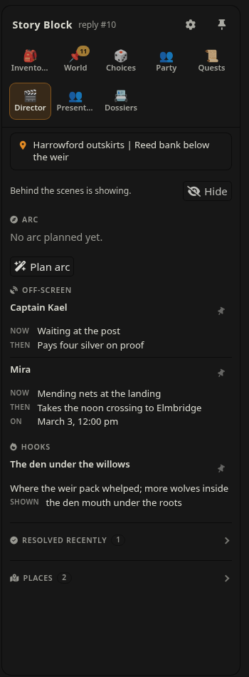
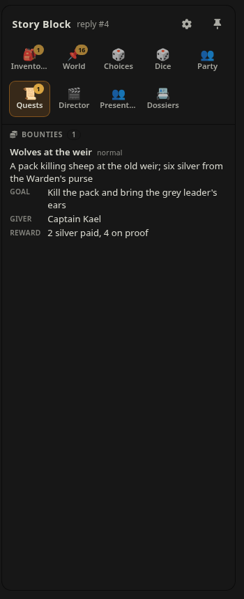

# Story Director v0.9.9

A SillyTavern extension that keeps a story's world moving consistently. It **tracks**
off-screen agendas, world events, hooks, quests and clocks, works out in code what is **due**, and
injects a short **note** before every reply with what is due, arriving and relevant to the
scene. The model writes only what changed; nothing it forgets to copy is ever lost.

Works on top of [Story Block](https://github.com/kohz87/Story_block) (0.6 or newer). It keeps
a **place book** of everywhere the story goes, on a map when the scene's location carries
coordinates, with distances, directions and trip estimates. With a
**world pack** (your map as JSON, optional) it also checks travel: every leg against the real roads,
distances and paces, with corrections in the next note and a `/route` planner. And once per
story arc it **plans** the next arc with a model you choose, the way Megumin Suite's Story
Director does, but the plan becomes dated, tracked beats instead of a block of prose.

## Screenshots

From a demo session with [Story Block](https://github.com/kohz87/Story_block), [NPC State Delta](https://github.com/kohz87/npc_state_delta) and [RPG Battle](https://github.com/kohz87/rpg_battle).

| Director tab, behind the scenes revealed | Quests tab |
| --- | --- |
|  |  |

## Why

Models are good at judgment and prose, and bad at arithmetic, lookups, comparing two lists and
remembering things that were last mentioned forty replies ago. A World State block that the
model rewrites in full every reply drops lines, duplicates them, renames them, misses due dates
and lets quiet threads fade. Story Director keeps that memory in code instead:

- **The model writes changes, not lists.** Each reply ends with a short hidden `<Director>`
  block: `+` new, `~` changed, `-` resolved, `!` a due item fired. Anything it leaves out
  stays as it was.
- **Code decides what the model sees.** Before every reply, only what is due, arriving or
  relevant to the scene goes into the note, within a token budget.
- **Quiet threads go on a shelf, not away.** Records unseen for a while are left out of the
  note and come back on their own when their name, place or date comes up.
- **Swipes, edits and branches just work.** The tracker for any point in the chat is replayed
  from the `<Director>` blocks up to that reply.

## Install

1. Install and enable **Story Block** 0.6 or newer.
2. **Extensions → Install extension**, paste `https://github.com/kohz87/Story_director`.
3. Reload. Settings are under **Extensions → Story Director**; the tracker is the
   **Director** tab in Story Block's sidebar.

## Quick start

1. Open a chat with a World State block (Story Block's `World_State` template, or your own;
   pick it under **Scene block**).
2. Set your **calendar**: Gregorian, or your world's months (one per line, `Name` or
   `Name | days`) and era.
3. Already tracking Off-Screen, World, Hooks or Clocks lines in your World State? Press
   **Seed from World State** once: they become tracked records.
4. Play. The note goes in before each reply; the model answers with its `<Director>` changes,
   which Story Block hides.
5. Trim your preset: the World State list sections and their rules, writer_state and
   Megumin's Story Tracker are no longer needed. Keep the scene part (time, place, people).

## The change lines

```
<Director>
+ agenda Courier — now: rides south from Shorn | then: delivers the writ | on: Haywane 13
~ Senior Listener Geva — then: files the warrant | on: Haywane 13, 09:00 am
- Thys — left the city
! Canal Street Granary Fires — curfew declared
</Director>
```

| Op | Meaning |
|---|---|
| `+ kind Key — summary \| label: value` | New record. Kinds: `agenda` (someone off-screen), `event`, `hook`, `quest`, `clock`, `beat`, `secret` |
| `~ Key — label: value` | Change only these parts |
| `- Key — reason` | Resolved (superseded when the reason says so) |
| `! Key — what happened` | A due item happened; its `then` becomes `now` |

A `~`, `!` or `-` on a key that is not tracked goes to the one active record it plainly means:
the same words once case, punctuation, a leading *the/a/an* and small words (*in, at, of, on,
to, for, from, and*) are set aside, or one key's words inside the other's (two words or more),
or three quarters of the words shared; `~ Footing in Bluewatch — …` changes *Footing at
Bluewatch*, and the Director tab notes it. Two such records are never guessed between. With
none, a `~` that carries something becomes a new hook (a `type:` that names a kind, such as
`type: clock`, sets that kind instead), a `-` does nothing, and any other line is ignored: a
warning in the Director tab, and one line in the next note's `Corrections:` (`"Key" is not
tracked: add it with "+ kind Key — …" before changing it.`), only for the latest reply.

Fields: `now`, `then`, `on` (when `then` happens), `due` (when a clock fires), `shown`
(`none`/`sign`/`warning`), `leg` and `arrive` (travel), `place`, `people`, `encounter` (the
foes of a planned fight); for a quest also `type`, `giver`, `goal`, `reward`, `step` and
`difficulty`. Dates go only in `on`, `due` and `arrive`. The note tells the model all of this in
about 140 tokens.

Parts are separated by `|`. Fields a model runs together with commas or semicolons instead
(`type: contract, giver: Nelke, reward: 2 silver`) are split the same way (since 0.9.8), but
only before one of these field names, so a comma inside a value (`giver: Nelke, the clerk`)
stays.

### Quests

Long-running work your character has taken on: bounties, contracts, favours owed, a hunt.
Short errands that end within the scene do not need one.

```
+ quest Bounty on Kettle Jack — type: bounty | giver: Warden Hale | goal: bring him in alive | reward: 40 crowns | due: Haywane 30 | difficulty: hard
~ Bounty on Kettle Jack — step: cornered at the weir
- Bounty on Kettle Jack — turned in, paid
```

One kind covers them all; `type` is the category: `main`, `side`, `bounty`, `contract`,
`mission`, `favour`, or any word you like. Writing the category as the kind (`+ bounty Wolf
pelts — …`, `+ contract …`) sets the type by itself.

`difficulty` is one of `easy`, `normal`, `hard` or `nightmare`; a quest without one is
`normal`. The obvious other words are read as one of the four (`trivial`, `simple` → easy;
`medium`, `moderate` → normal; `difficult`, `tough` → hard; `deadly`, `impossible`, `extreme` →
nightmare), and anything else as normal. The note mentions it next to the type when it is not
normal (`Bounty on Kettle Jack (bounty, hard) — …`). Other extensions can scale by it: RPG
Battle offers quest XP by difficulty when a quest is finished.

- A new line with no kind is a quest only with a `giver`, a `reward` or a quest `type` (since
  0.9.3); a `goal`, `step` or `difficulty` alone makes it a hook.
- A quest starts only when your character **accepts** it, and only for a job that outlasts the
  scene, not an errand; an offer not yet taken is a hook. When you take on a hook that is
  already tracked (register for the bounty, agree to the job), `~ Sheep-killer — giver: Hobb |
  reward: 4 silver` makes it the quest (since 0.8.6), keeping its key, description and history.
  A hook or event becomes a quest when a `~` names it one (`type: quest`, or a category such as
  `type: bounty`), or when it is a **job** (it has, or the `~` gives it, a `giver`, a `reward` or
  a quest category) and the `~` moves it on (`giver`, `reward`, `goal`, `step` or `difficulty`).
  So `~ Wolf pelts — step: tracking the pack` on a bounty the arc planner offered with its reward
  makes it a quest, while a `step` on a plain thread does not (models write `step:` for any
  progress). Arc beats never become quests, and an untracked key written with a giver or reward
  is added as a quest. `+ quest Key` on a hook or event already tracked makes it the quest too
  (since 0.9.9), keeping its key and history.
  The arc planner offers work as hooks and never completes a quest for you.
- **Finishing a quest:** `- Key — outcome` closes it, and the change instruction says so for
  quests ("done or failed: - it"). Models often write the end another way, so these close it too
  (since 0.9.1), with a note in the Director tab: a `~` whose `step:` or `now:` (a quest's) or
  `status:` / `outcome:` (any record) is just *done*, *completed*, *finished*, *failed*,
  *abandoned*… (alone or before punctuation: `step: completed — Garrow paid`; `step: complete
  the hunt` is still a step), and a `!` on a quest that says it was completed, done, turned in,
  rewarded or failed. A failure closes the quest without counting as done (no quest XP).
- **The story closes quests, not a click** (since 0.9.5). When an open quest's own `step` or
  `now` reads as over (*wolf slain, reward collected*, *delivered*, *failed*) but no line closed
  it, the note adds a **Quest check**: "the story may have finished Sheep-killer. If it has,
  close it with - Key — outcome; if not, leave it." Only while the model writes change lines.
- **A quest is finished once.** A later line closing it again (models repeat `- Quest — done`)
  changes nothing (since 0.9.7): it stays finished in the reply that first closed it, so RPG
  Battle's quest XP is never given twice. Reopen it with `+ quest …` and it can be finished anew.
- **Giving up** (since 0.9.6): a failure, never quest XP, however it is written: `failed`,
  `abandoned`, `gave up`, `forfeit`, `quit`, `walked away`, `backed out`, `called off`… When
  **your own message** (or the reply's narration) gives up an open quest in so many words, in a
  sentence naming the quest or its giver ("I give up on the Sheep-killer bounty", "Tell Garrow I
  quit"), the Quest check asks the story to close it: "Ren may be giving up Sheep-killer. If
  they do, close it with - Key — abandoned; if not, leave it." A negation ("I won't give up")
  does not count, and nothing is closed by the message itself.
- **Abandon** under each open quest in the Quests tab is the one closing that is yours to make
  (it asks twice): your character gives the job up. `- Key — abandoned` goes into the latest
  reply, so deleting or swiping that reply takes it back; it counts as a failure, so RPG Battle
  offers no quest XP for it.
- `due` is the **deadline**: when it is reached, the note says so ("deadline Haywane 30
  reached"), and the story decides what that costs.
- Quests **never go dormant**. A quest untouched for forty replies stays in the note, and its
  giver's name in the scene counts as a mention.
- They have their own **Quests** tab in Story Block's sidebar (it appears with the first
  quest), grouped by type: Main, Side, Bounties, Contracts, Missions, Favours, then your own
  types. Each shows its difficulty, goal, step, giver, reward, deadline and place, marked when the
  deadline is close or has passed; finished quests fold away with how they ended. The badge is
  the number of open quests. Nothing in it is hidden: quests are promises you made, not
  spoilers.

### Encounters

A record with an `encounter` is a planned fight. Story Director stores and schedules it and
hands the foes over; it never resolves a fight. The RPG Battle companion extension does that
in code, with buttons.

```
+ beat Ambush at the weir — on: Haywane 14 | place: Weir road | encounter: 3 bandit, bandit captain (boss)
```

The value is free text in RPG Battle's shape: comma-separated groups of
`[N ×|N x|N ]name[ (boss)][ rank X][ role]`, such as `3 bandit, bandit captain (boss)` or
`2 x dire wolf rank D`. It is kept as written. It usually sits on a `beat`, but a quest (a
bounty's target) or a clock (one that fires as an attack) can carry one too.

- **When it is due** (or arriving), the note's Due line says who is coming: `Due now: Ambush at
  the weir (Haywane 14) (fight: 3 bandit, bandit captain (boss))`, and the Pacing line adds one
  sentence: the fight starts when the scene reaches it, the foes appear, and the reply stops at
  the first blow, because the fight is resolved outside the story. RPG Battle then offers a
  **Fight?** notice filled in with the foes.
- **Before then**, the kind lines show it compactly (`Beats: Ambush at the weir (Haywane 14) ·
  fight: 3 bandit, bandit captain (boss)`), and the Director tab shows an `encounter` row and a
  `fight` tag.
- **Afterwards** the model closes the record the usual way, with `!` or `-` and what happened.
- The **arc planner** may plan one or two per arc, as a `BEAT: … | encounter: …` line (or an
  `ENCOUNTER:` line), only where the story would really come to blows: a quest's target, or an
  ambush an agenda sets up.

## The note

```
[Story Director · CY 611, Goldwane 16, 09:00 am · Auvoth]
Due now: Saartje's sale (Goldwane 16)
Off-screen: Geva — Bailiff Court → files the warrant (Goldwane 17)
World: Canal Street fires — curfew in force
Hooks: River stranger — who pulled Ren from the sump
Clocks: Hollin's Reach graves — the dead rise (Goldwane 28) · shown: sign
Beats — The Weir Debt (who sold the route, and what it costs Ren): Toll riders reach the ford (Goldwane 19)
Do not reveal: who sold the weir route
Pacing: the world keeps its schedule and the scene keeps its flow. …
<how to write changes>
```

**One home for each thing (0.9.3).** The current arc has no line of its own: its name and what it
is about head the **Beats** line, so the arc is carried by its beats, and a beat that comes due
moves to *Due now* like anything else. While Story Director keeps the timeline and writes the
agendas into your World State's **Off-Screen** section (*Mirror Off-Screen*, on by default), the
note leaves its *Off-screen* line out, since that section already shows every agenda; one that
is due or arriving is still on *Due now* or *Arriving*. With Story Block 0.9.5 or later, the
World State itself then leaves out Unresolved Threads, Planted Seeds, Consequence Timers and Arc
Phase: hooks, clocks and the arc are Story Director's, so the model gets them from one place.

Whenever something is scheduled, a short **Pacing** line says how a schedule meets a scene:
bring a due item in only where it fits (on-screen if your character is there, otherwise later
as news, signs or aftermath), never cut into or bend the current scene for a beat, never decide
what your character does, and let what cannot fit happen off-screen or slip to a later date.

**Long parts are trimmed in the note only.** A part runs to at most 12 words for what a record
is doing and when (`now`, `then`, `on`, `due`, `arrive`) and 16 for what it is (`desc`, a
quest's `goal`, `step`, `giver` and `reward`, a fight's foes), then ends in "…" at a word
boundary (before an unclosed bracket, when it can). The tracker keeps every word: the Director
and Quests tabs, the API and the capture and planner calls see the full text, so a long part is
no longer reported as a problem.

It is injected as a system message at a shallow depth (1 by default), so the cached history in
front of it is untouched.

## Places and the map

Every reply's World State says where the scene is. Story Director reads it as the story goes
and keeps a **place book**: each place (the first part of the location, "Auvoth"), the spots
inside it ("Seventh Seal Terrace"), how often and when the story was there. It is the
**Places** section of the Director tab, and it is shown even while the tab is hidden: you
were there.

When the location carries **map coordinates**, like
`**🌤 Loc:** Auvoth | Seventh Seal Terrace | [59.0, 110.0]` (many presets ask for them),
the places go on a small map, north up, with the distance and direction of each from where
the scene is now ("136 km NW"). Places within about 100 km count as "here" when the note
picks what is relevant. Nobody has to write a map file for any of this.

**Settings → Map & travel** says how to read the coordinates:

| Setting | Default | |
|---|---|---|
| Travel | Pre-modern | *Pre-modern*: on foot, horse, wagon, boat, in km a day. *Modern*: car, bus, train, ferry, plane, in km an hour (see [Modern travel](#modern-travel)). A world pack says its own era |
| North is | Up | *Up*: y grows to the north (a chart). *Down*: y grows to the south (an image, where 0,0 is the top left) |
| East is | Right | Which way x grows |
| km per unit | 1 | How far one coordinate unit is (a world pack's `scale_km_per_unit` sets it) |
| Road factor | 1.25 | Roads wind: straight-line km × this for trips over land |

**`/route` without a world pack** estimates from the coordinates:

```
/route Shorn to Auvoth
Shorn → Auvoth ≈ 219 km SE (≈ 175 km straight × 1.25) · foot 20/day · 12 days (1 rest) · arrive …
```

The days follow the same rules as roads: rounded up to the half day, a rest day after every six
days on land, none for couriers; boats and flight go straight. Paces without a pack: foot 20,
ride 35, wagon 18, boat 35, courier 70 km a day (or `rate=`).

With **Travel** set to *Modern*, the same estimate counts hours:

```
/route Home to Coast car
Home → Coast ≈ 1250 km NE (≈ 1000 km straight × 1.25) · car 70 km/h · 1 day 8 h (1 night on the way) · arrive …
```

Modern paces without a pack, door to door: foot 5, bike 15, car and motorbike 70, bus 50,
train 90, metro 30, ferry 30, ship 35, plane 750 km an hour, plus boarding (train 15 min,
ferry 30 min, ship 1 h, plane 2 h).

## World packs and travel

A world pack is optional: it adds real roads. It is your map as JSON: places, roads (with km
and a road code), paces per road and mode, and travel rules. Import it under **Settings → Map &
travel → World pack** (file or paste). See [Making a world pack](#making-a-world-pack) for a prompt
that writes one from your lorebook or map. A pack's place coordinates also fill in the place book,
and they **win over the coordinates a reply writes**: the pack is your map, while the model's
numbers drift. When a reply's coordinates for a place differ from the pack's by more than one map
unit, the Places section says so ("the story wrote 70, 104"), and distances and directions use the
pack's. If it brings a calendar, you are asked whether to use it.

```jsonc
{
  "calendar": { "era": "CY", "days_per_month": 30, "months": ["Dawnwane", "…"] },
  "pace_km_per_day": { "B": { "foot": 20, "ride": 35, "wagon": 18 }, "F": { "foot": 16, "ride": 28, "wagon": 14 },
                       "W": { "boat": [30, 45] }, "T": { "foot": [14, 22], "ride": "foot", "wagon": null } },
  "courier_multiplier": 2,
  "travel_rules": { "round_edge_up_to_days": 0.5, "rest_day_every_active_days": 6,
                    "crewed_water_rest_days": false, "levee_roads": ["Grand Vein River"], "no_levee": ["Bluewatch Branch"] },
  "places": { "Shorn": { "x": 50, "y": 95, "region": "Shornmarch" }, "…": {} },
  "edges": [ { "a": "Shorn", "b": "Varnhold Watch", "km": 35, "code": "B", "corridor": "Shorn–Auvoth Bastion Road" } ]
}
```

**How travel is worked out:**

- The shortest road by km that the mode may use: wagons stay off trails, mountains, tunnels and
  hidden paths (`null`); riders go at foot pace where a code says `"ride": "foot"`; water is by
  boat only unless the corridor is a levee road.
- **Each road rounds up to the next half day** (`round_edge_up_to_days`), and the days add up.
- One rest day after every 6 travel days on land; none for couriers (relays) or crewed boats.
- Couriers ride at the ride pace × `courier_multiplier`. A range `[low, high]` uses its middle
  unless a rate is given; a leg's stated rate inside the range is accepted.

**What is checked** for every leg a reply writes or changes (`leg: FROM → TO KM CODE, MODE
RATE/day → DAYS`, `arrive:` its arrival):

| Problem | Example |
|---|---|
| Not one road | `Shorn → Auvoth 130 B` is three roads; the first is `Shorn → Varnhold Watch 35 B` |
| A road that does not exist | `Bluewatch Village → Siltbarrow`; the real exits are listed |
| Wrong start | A new leg must start where the last one ended |
| Wrong km | More than 5 % off the road's length |
| A mode the road does not allow | A wagon on a mountain road |
| Wrong arrival | More than half a day off what the pace gives, counted from when the leg was set |

Each problem comes with the corrected leg, which goes into the next note under
`Corrections:`. With a map, places one road away from the scene also count as "here" when
the note picks what is relevant.

**`/route FROM to TO [mode] [rate=N]`** (also `from=` / `to=` / `mode=`) prints the roads,
km, pace, days and the arrival from the scene's current time, for example:

```
/route Shorn to Auvoth courier
Shorn → Varnhold Watch 35 B → Wolfmere Outpost 55 B → Auvoth 130 B = 220 km · courier 70/day · 3.5 days · arrive …
```

The Director tab has the same tool under **Route**.

### Modern travel

For a story set now (or in the last century or so), a pack with `"era": "modern"` (or paces
under `pace_km_per_hour`) travels by modern roads and transport. Everything above works the
same, with these differences:

- **Times are hours.** Each road rounds up to the quarter hour (`round_edge_up_to_hours`), and
  the result reads like a clock: `45 min`, `2 h 15 min`, `1 day 3 h`.
- **Nights on long drives:** whoever drives, rides or walks (car, motorbike, bike, foot) stops
  for the night after 10 hours on the road (`drive_hours_per_day`). Trains, buses, ferries,
  ships and planes go on.
- **Boarding:** a train waits 15 minutes, high-speed rail and ferries 30, ships an hour, a
  flight 2 hours (check-in and security). A pack sets its own with `"board_hours"` in a code's
  paces.
- **Getting to the station:** a trip by train, plane, ferry, bus or metro reaches its station
  by a short taxi ride or walk (roads up to 60 km), shown as `(car)` in the route. Driving
  trips drive the whole way.
- **Fastest, not shortest:** routes take the quickest way, so a motorway's detour or a flight
  beats a slower direct road.

| Code | Road | Modes (km an hour) |
|---|---|---|
| `MW` | motorway or highway | car 100, motorbike 100, bus 80 |
| `RD` | road | car 60, motorbike 60, bus 45, bike 18, foot 5 |
| `ST` | city streets | car 25, motorbike 25, bus 18, bike 15, foot 5 |
| `OR` | off-road or dirt track | car 30, motorbike 30, bike 10, foot 4 |
| `TR` | trail or footpath | bike 12, foot 4 |
| `RL` | railway | train 90 |
| `HS` | high-speed rail | train 250 |
| `MT` | metro, subway or tram | metro 30 |
| `FY` | ferry | ferry 30 (cars and people aboard) |
| `SL` | sea lane | ship 35 |
| `AR` | air route | plane 750 |

A mode a code does not list cannot use it: no bikes on the motorway, no cars on a footpath.
A pack's `pace_km_per_hour` changes any of these (`"MW": { "car": 120 }`), takes a mode off a
code (`"bus": null`), or adds codes of its own, one to three capital letters
(`"MAG": { "train": 400, "board_hours": 0.5 }`). The model can write the modes as it likes
(`drive`, `taxi`, `cycling`, `subway`, `fly`). Legs read and are corrected in hours:

```
leg: Home → Downtown 14 ST, car 30/h → 0.5 h
/route Downtown to North City plane
Downtown → Airport 25 MW (car) → North City 920 AR = 945 km · plane 750 km/h · 2 h boarding · 3 h 30 min · arrive …
```

Arrivals are checked to the quarter hour, or a tenth of the trip when that is more.

### Making a world pack

You do not need to write the JSON by hand. Give a model your world, and the prompt below has it
write the pack; then import it and read the notes the import gives back.

**What to give it:** whatever you have of your map, such as a lorebook's places and travel
times, a description of the regions, or the place names and coordinates your preset already
writes in the scene's location (`Auvoth | Terrace | [59.0, 110.0]`). For a map image, describe it
or let a model that reads images look at it. The more distances and directions you give it, the
less it has to invent.

**What it must get right** (the import checks the first four and lists what is wrong):

- **Every road's two places are in `places`**, spelled the same.
- **Roads join neighbours only:** one road per stretch between two places, never a long trip
  through other places as one road. Routes are found by chaining roads.
- **`km` is the road's length** and never shorter than the straight line between its places
  (coordinates × `scale_km_per_unit`); roads wind, so 1.1 to 1.4 × the straight line is normal.
- **`y` grows to the north** (a chart). If the coordinates come from an image, where y grows
  downwards, keep them and set **North is** to *Down* after importing; a pack whose `bearing`s
  fit that gets one note saying so.
- **Every road code it uses has a pace** in `pace_km_per_day` (at least `R`; codes without land
  paces go at the `R` pace). A modern pack needs none: the [built-in codes](#modern-travel)
  have theirs.

| Code | Road | Code | Road |
|---|---|---|---|
| `R` | maintained road | `W` | river or canal (boats; levee roads also on foot) |
| `B` | bastion road | `S` | sea (ships) |
| `F` | frontier road | `D` | deep sea (`vessel` pace) |
| `C` | caravan | `A` | aerial (`flight` pace) |
| `L` | local | `T` | trail |
| `G` | dungeon approach | `M` | mountain |
| `X` | seasonal or expedition | `U` | tunnel |
| | | `H` | hidden |

A pace is km a day: a number, a range `[low, high]`, `"foot"` (riders go at foot pace there) or
`null` (that mode cannot use the road; wagons stay off trails and mountains this way).

The codes below are the pre-modern ones; a modern pack uses [its own](#modern-travel).

**The prompt** (paste it into any capable model, followed by your material):

````text
You are converting a fictional world into a world pack: one JSON object, and nothing else
(no comments, no code fence, no explanation). Use only what the material below says or clearly
implies; where you must invent a distance or position, keep it consistent with the rest.

Shape:
{
  "source": "<world name>",
  "scale_km_per_unit": <km per coordinate unit, e.g. 10>,
  "pace_km_per_day": {
    "R": { "foot": 20, "ride": 35, "wagon": 18 },
    "F": { "foot": 16, "ride": 28, "wagon": 14 },
    "T": { "foot": [14, 22], "ride": "foot", "wagon": null },
    "M": { "foot": [10, 15], "ride": "foot", "wagon": null },
    "W": { "boat": [30, 45], "upstream": [20, 30], "downstream_favorable": [50, 60] },
    "S": { "ship": 110 }
  },
  "courier_multiplier": 2,
  "travel_rules": { "round_edge_up_to_days": 0.5, "rest_day_every_active_days": 6, "crewed_water_rest_days": false },
  "places": {
    "<Place name>": { "x": <number>, "y": <number>, "region": "<region>" }
  },
  "edges": [
    { "a": "<Place>", "b": "<Place>", "km": <number>, "code": "<road code>", "corridor": "<road or river name, or null>", "bearing": "<compass of b from a>/<compass of a from b>" }
  ]
}

Rules:
- Places: every town, village, fort, crossing, camp and landmark a traveller stops at. Names
  exactly as the material spells them. One coordinate system for all; y grows to the NORTH, x to
  the east. The coordinate distance between two places × scale_km_per_unit is the straight-line
  distance in km.
- Edges: only between neighbouring places, one edge per stretch of road, river or sea lane.
  A trip that passes through a place is two edges. Both ends must be in "places".
- km: the length of that stretch, 1.1 to 1.4 × the straight-line distance (never less).
- bearing: an 8-point compass pair, e.g. "SW/NE" when b lies south-west of a. It must match the
  coordinates.
- code: R maintained road, B bastion road, F frontier road, C caravan, L local, G dungeon
  approach, X seasonal or expedition, T trail, M mountain, U tunnel, H hidden, W river or canal,
  S sea, D deep sea, A aerial. Every code you use needs an entry in pace_km_per_day (W, S, D, A
  use boat/upstream/downstream_favorable, ship, vessel and flight).
- Paces are km per day: a number, [low, high], "foot" (that mode goes at foot pace) or null
  (that mode cannot use it). Adjust the example paces to the world.
- Optional: "calendar": { "era": "<era>", "days_per_month": 30, "months": ["<month>", ...] }
  when the material names its months; "levee_roads" / "no_levee" in travel_rules for rivers
  with or without a towpath road.

Before answering, check every edge: both places exist, km ≥ straight-line distance, and the
bearing agrees with the coordinates.

Material:
````

**For a modern world**, use this prompt instead:

````text
You are converting a modern-day setting (real or fictional) into a world pack: one JSON
object, and nothing else (no comments, no code fence, no explanation). Use only what the
material below says or clearly implies; where you must invent a distance or position, keep it
consistent with the rest. For real places, use their real distances.

Shape:
{
  "source": "<setting name>",
  "era": "modern",
  "scale_km_per_unit": <km per coordinate unit, e.g. 1>,
  "travel_rules": { "round_edge_up_to_hours": 0.25, "drive_hours_per_day": 10 },
  "places": {
    "<Place name>": { "x": <number>, "y": <number>, "region": "<city, district or region>" }
  },
  "edges": [
    { "a": "<Place>", "b": "<Place>", "km": <number>, "code": "<road code>", "corridor": "<road, line or route name, or null>", "bearing": "<compass of b from a>/<compass of a from b>" }
  ]
}

Rules:
- Places: homes, neighbourhoods, towns, stations, airports, ports, landmarks and anywhere a
  trip starts, ends or changes. Names exactly as the material spells them. One coordinate
  system for all; y grows to the NORTH, x to the east. The coordinate distance between two
  places × scale_km_per_unit is the straight-line distance in km.
- Edges: only between neighbouring places, one edge per stretch. Two places joined by a road
  and a railway get two edges. Airports join by air routes (AR), stations by rail (RL, HS),
  ports by ferry (FY) or sea lanes (SL); give each station, airport and port a short road
  (ST or RD) to the place it serves. Both ends must be in "places".
- km: the length of that stretch, 1.1 to 1.4 × the straight-line distance for roads and rail
  (never less); air and sea routes about the straight line.
- bearing: an 8-point compass pair, e.g. "SW/NE" when b lies south-west of a. It must match the
  coordinates.
- code: MW motorway or highway, RD road, ST city streets, OR off-road or dirt track, TR trail or
  footpath, RL railway, HS high-speed rail, MT metro, subway or tram, FY ferry, SL sea lane,
  AR air route.
- Only if the setting needs other speeds: "pace_km_per_hour": { "<code>": { "<mode>": <km an
  hour> } } with modes foot, bike, car, motorbike, bus, train, metro, ferry, ship, plane
  (null takes a mode off a code); "board_hours" in a code sets its boarding time.
- Optional: "calendar": { "preset": "gregorian" } for real dates.

Before answering, check every edge: both places exist, km ≥ straight-line distance for roads
and rail, and the bearing agrees with the coordinates.

Material:
````

**After importing**, the message lists notes such as `Bluewatch Village – Hollin's Reach is 40
km, but the places are 85 km apart in a straight line` or `… says Hollin's Reach lies E of
Bluewatch Village, but the coordinates put it SW`. Fix those in the JSON (or ask the model to)
and import again. Then try `/route` between two places you know, and look at the map in the
Places section: if it is upside down, change **North is**.

## Arc planning

Tracking and the note happen every reply, in code. **Planning is one model call per arc.**

- **When:** *Manual* (the **Plan arc** / **End arc** buttons in the Director tab), or
  *Automatic*: when there is no arc yet, when every beat of the arc has played out, or when no
  beat is due within the stall window (7 story days by default). The buttons work in both.
- **Model:** *Same as chat*, or any SillyTavern **connection profile** (its own API and model; a
  cheaper or faster one is fine). A missing profile fails with a message; it never falls back
  to another model.
- **What the planner reads:** the last messages (60 by default), the tracker, the current time
  and place, nearby places (with a world pack), your **genre and tone**, your **Director's
  note** (a goal, a pace, a beat you want) and the previous arc.
- **What it writes:** an arc, 3–6 dated beats, an agenda for each NPC the arc moves, hooks,
  clocks, and a secret for every secret it creates. At most one or two beats are fights (with
  an `encounter`; see [Encounters](#encounters)). Relative dates ("in 2 days", "tomorrow at
  dusk") become dates in your calendar. Plans that act for your character are flagged.
- **While it runs** a notice stays up ("Planning the next arc… on *profile*") until the plan is
  ready; a failure (the API refused, the answer was unusable) says why in a red notice.
- **Beats leave room:** the planner is told that a beat's date is when the world acts, not an
  appointment for your character. Every beat must work whether or not you are there, and may
  slip; the note's Pacing line tells the storyteller the same every reply.
- **Review:** the plan waits in the Director tab as editable change lines; **Accept** writes them
  into the latest reply (deleting that reply undoes the plan), **Discard** drops it, **Plan
  again** asks for another. Turn on *Use plans without review* to skip this.
- **The Director's note is used once:** when the arc it shaped is accepted (by you or without
  review), the note is cleared, so a goal you forgot about cannot steer later arcs. Discarding
  the plan keeps it, and so does editing the note while the plan waits. Turn on *Keep the note
  for every plan* to keep it for good.

From then on the arc's name heads the note's Beats line with its next beats, and its secrets
are kept under "Do not reveal". The planning prompt is editable (with reset); its macros are
`{{recent}}`, `{{tracker}}`, `{{now}}`, `{{place}}`, `{{nearby}}`, `{{note}}`, `{{genre}}`,
`{{previous_arc}}`, `{{user}}` and `{{char}}`.

## Capture (for models that skip the change lines)

Some models forget the `<Director>` block, or garble it. **Capture** hands that job to a second
call on a model of your choice (a small, fast one is enough):

- **When a reply has no `<Director>` block:** the model still writes its own changes; capture
  fills in only when it did not.
- **Always:** the note no longer asks the model for change lines at all; capture writes them
  for every reply.

The capture call reads only that exchange (your message and the reply) with the tracker for
context, and follows World State Alpha's capture rules: only what the exchange established,
never plans or guesses; a claim in dialogue stays a claim, a rumour a rumour. Changes to keys
that are not tracked are dropped (unless the key plainly means one tracked record, as above;
capture never adds a record from a `~`), and capture never starts an arc. Its lines are
written into the reply like the model's own, so swipes and edits behave the same.

## Coming from World State Alpha

**Settings → Existing chat → Import from World State Alpha** takes an exported World State
Alpha bundle. Its active facts and developments become **World** records (developments keep
their trend; facts are marked settled and fold away in the tab), keyed by the first words of their summary, with their
anchors as the names to watch for. Resolved and superseded records stay behind. Turn World
State Alpha off afterwards; the two would inject overlapping notes.

## Settings

The panel (Extensions → Story Director) has the Story Suite's shared look, the same as the other
story extensions': a quick bar (the **Track the story** and **Hide behind the scenes**
switches, shown as Enabled/Disabled, then **Plan arc** and **Seed from World State**) and
folding sections, each with a one-line summary of what it is set to: Tracking & note,
Calendar, Map & travel, Arc planning, Capture, and Existing chat & compatibility. They start
closed; the ones you open are remembered in this browser.

| Setting | Default | |
|---|---|---|
| Tracking | on | Off: no note, no checks |
| Scene block | `World_State` | Where the time and place are read |
| Depth | 1 | Chat depth of the note |
| Budget | 1000 tokens | Most the note may use; lowest-priority records drop first |
| Dormant after | 15 replies or 30 story days unseen | Left out of the note until mentioned again |
| Due soon | 3 days | Anything due this soon is never dormant |
| Calendar | Gregorian | Or your own months and era |
| Mirror Off-Screen | on | Writes active agendas into the scene block's Off-Screen section, for readers who keep that section in Story Block's World State (once tracking has started) |
| Source of truth | Automatic | Calendar, timeline and NPCs: who keeps each when other story extensions are installed (see [Working with the other story extensions](#working-with-the-other-story-extensions)) |
| Map | north up, east right, 1 km per unit, roads × 1.25 | How the scene's coordinates read (see Places and the map) |
| World pack | none | Optional roads: places, edges, paces and travel rules, as JSON |
| Arc planning | manual, same as chat | When to plan, which model, how much chat it reads, answer length, stall window, review, genre and tone, Director's note (used once, or kept), prompt |
| Capture | off | Off, when a reply has no `<Director>` block, or always; its model and answer length |

## The Director tab

What is due and arriving, every active record by kind except quests (they have their own
tab; pin a record to keep it in the note), the
arc and its beats, the dormant shelf, secrets, what was resolved recently, problems with the
last reply's changes, the places the story has been (with a map when there are coordinates),
and the route tool.

**Problems** with the last reply's changes are listed by severity: errors and warnings (a
missed date, a line on a key that is not tracked, a travel leg that does not add up) stay in
view; harmless **notes** (a key read as a near one, a record added from a `~`, something still
due, a date written in prose) fold into one closed **Notes** fold with their count. Only
warnings and errors raise the toast after a reply.

**Settled** records (World State Alpha's facts, or any record with `settled: yes`) are true
and going nowhere, so each section folds them into a closed **Settled** fold after its live
records. Folds you open stay open while you play; only *Do not reveal* closes again.

**It starts hidden.** The tracker is the story behind the scenes, so by default the tab shows
only the time and place, counts and what you can do (plan or end an arc, accept a waiting plan
without reading it, seed, route). **Reveal** opens it for that chat until you **Hide** it again
or reload; hidden text is not put on the page at all. Turn this off with **Hide behind the
scenes** in the settings' quick bar.

## Roadmap

| Version | Adds |
|---|---|
| 0.1 | Tracker, change lines, calendar, Due now, relevance and budget, dormant shelf, checks, the tab, seeding, Off-Screen mirror |
| 0.3 | World packs (places, routes, paces), travel legs checked and corrected, `/route` and the route tool |
| 0.4 | Arc planning on a model you choose (a connection profile or the chat's model): manual or automatic; Director's note, genre, review |
| 0.5 | Capture call on a model you choose (fallback or always); World State Alpha import |
| 0.6 | Place book from the scene's location, map settings (axes, km per unit, road factor), the Places map, `/route` estimates without a world pack |

The full design is in [docs/DESIGN.md](docs/DESIGN.md), the module contract in
[docs/ARCHITECTURE.md](docs/ARCHITECTURE.md).

## Working with the other story extensions

Story Director works alone. With Story Block, NPC State Delta or RPG Battle installed too, the
extensions find each other through the **Story Suite** handshake
([docs/STORY_SUITE.md](docs/STORY_SUITE.md)) and agree who is the source of truth for each
area, so the model is not told the same thing twice.

- While it tracks the story (the switch on, Story Block there), Story Director offers the
  **calendar**, the **timeline** (agendas, quests, clocks, arcs) and **NPCs**, and shares the
  same object as `globalThis.StoryDirector` (below). Turning tracking off stops it offering
  anything; it stays listed as switched off, so Story Suite can turn it back on.
- **NPCs** are NPC State Delta's while it is installed and on: it keeps who each NPC is.
  Story Director's agenda lines then give only what an NPC plans and when; one short line in
  the note, in the planner's request and in the capture call asks for that.
- **Calendar and timeline** are Story Director's on Automatic. NPC State Delta then uses its
  months and era (`calendar()`) instead of its own.
- **Settings → Existing chat & compatibility → Source of truth** has a choice per area:
  *Automatic* (the suite's order), *This extension*, or *The other one*. *The other one* stops
  Story Director offering that area to the others (it still reads dates with its own
  calendar); for the timeline it also stops the Off-Screen mirror while another extension
  keeps it. With no other story extension installed, every choice works like Automatic, and
  nothing changes.
- **Story Suite overlay:** with Story Block 0.9 or later and another story extension installed, *Manage
  all in Story Suite* (on top of the settings) opens one overlay for all of them, with this
  panel as a tab and one Source of truth table
  ([One place to manage them all](docs/STORY_SUITE.md#one-place-to-manage-them-all)). The
  overlay can also show what Story Director adds to your next reply (`api.manage.tokens()`):
  the note as it would be sent now, per section, at about 4 characters a token, plus about 60
  tokens of output for the `<Director>` lines it asks for (none when capture writes them on
  *always*). Planner and capture calls are separate quiet calls and are not counted.

## For other extensions

`globalThis.StoryDirector` (`apiVersion: 1`) is read-only, and is also what Story Director
shares through the Story Suite (`StorySuite.api('story-director')`):

- `calendar()`: the reader's calendar, `{ era, months: [{ name, days }] }` (plain copies; the
  Gregorian months until a calendar is set):

  ```js
  { era: 'CY', months: [{ name: 'Dawnwane', days: 30 }, { name: 'Haywane', days: 31 }, …] }
  ```

- `timeAt(index)`: the story time known at message `index`, in minutes on your calendar, or
  `null` when no scene block has stated one yet.
- `formatTime(abs)`: such a time written the way your calendar writes it.
- `encountersAt(index)`: the planned fights the story has reached at message `index`, read the
  way the note reads the scene there. Due (or arriving) ones come first, then those whose date
  falls within the due-soon window (3 story days by default):

  ```js
  [
      { key: 'Ambush at the weir', id: 'ambush at the weir', kind: 'beat',
        encounter: '3 bandit, bandit captain (boss)', place: 'Weir road', on: 'Haywane 14', status: 'due' },
      { key: 'Wolves on the ridge', id: 'wolves on the ridge', kind: 'beat',
        encounter: '2 x dire wolf rank D', place: '', on: 'Haywane 16', status: 'soon' },
  ]
  ```

  It returns `[]` when there are none, or when anything goes wrong. There is nothing to report
  back: the model closes the record with `!` or `-` when it narrates the outcome.
- `questsDoneAt(index)`: the quests the assistant reply at message `index` finished (a `-` line
  in that reply closed them, not as failed, abandoned, expired or superseded); quests finished
  in earlier replies are not listed, so a swipe is read afresh. `difficulty` is always one of
  `easy`, `normal`, `hard`, `nightmare`:

  ```js
  [
      { id: 'bounty on kettle jack', name: 'Bounty on Kettle Jack', type: 'bounty',
        difficulty: 'hard', reward: '40 crowns', giver: 'Warden Hale' },
  ]
  ```

  Plain copies; `[]` when there are none, while tracking is off, or when anything goes wrong.

RPG Battle uses it to give back HP and MP as story time passes, to offer the fights the story
has planned, and to offer XP for a finished quest.

## Development

Plain ES modules, no dependencies, Node.js 24:

```sh
npm run check   # syntax check of index.js and src/
npm test        # node:test suites
```

## License

GPL-3.0.

## Credits

With thanks to [Arif-salah](https://github.com/Arif-salah).
